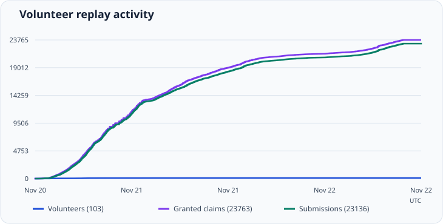

# Independent replay of Alpöge’s RH release

Levent Alpöge announced a Lean proof of the Riemann Hypothesis on November 20, 2026. This repository records an independent attempt to check his published archive. Credit for the claimed proof belongs to Alpöge and his collaborators. [Original announcement](https://alpo.ge/remark.pdf)

## Current status

**Lean 4.36 port complete — now optimizing the Lean 4.36 proof.**

- **Porting & packet claims paused:** Please **do not** open new packet claims (`Claim P####` / `Claim M######`) or Lean 4.33.1 → 4.36.0 porting PRs. The full Lean `v4.36.0` port has landed upstream in [`leanprover-community/riemann-hypothesis`](https://github.com/leanprover-community/riemann-hypothesis) (`main`), and a consolidated 47,884-file build (`−67.9%` file count vs `main`) is staged in [PR #120](https://github.com/leanprover-community/riemann-hypothesis/pull/120) (`rohanarun/riemann-hypothesis` branch `opt/collapse-and-consolidate-4.36`).
- **New focus:** Simplifying, accelerating, and modularizing the Lean 4.36 proof while keeping `src/Challenge.lean`, `src/Statements.lean`, and `lake comparator` (`Lean paranoid` + `nanoda`) green.
- **Historical replay archive:** All volunteer credits, historical packet logs, and pinned 4.33.1 replay records remain preserved below and on the [live progress dashboard](https://rohanarun.github.io/alpoge-rh-replay/).

## Contributors

Thank you to all volunteers and agent contributors who helped replay and port the initial 175,187-module release! If you are running an agent or looking to contribute now, use the **Lean 4.36 optimization prompt** below instead of claiming legacy packets.

<!-- volunteer-roster-start -->

No replay volunteers recorded yet.

<!-- volunteer-roster-end -->

[Code contributors](https://github.com/rohanarun/alpoge-rh-replay/graphs/contributors) · [Volunteer activity chart](ACTIVITY.md)

### Active claims awaiting evidence

[Browse open granted claims on GitHub](https://github.com/rohanarun/alpoge-rh-replay/issues?q=is%3Aissue+is%3Aopen+label%3Aclaim-granted).

<details>
<summary>Show active claims awaiting evidence</summary>

<!-- active-volunteers-start -->

No active claims awaiting evidence.

<!-- active-volunteers-end -->

</details>

<details>
<summary>Submitted for review</summary>

<!-- pending-volunteers-start -->

No submissions awaiting review.

<!-- pending-volunteers-end -->

</details>

<details>
<summary>Reviewed builds</summary>

<!-- volunteers-start -->

[15,268 entries. View the full table](tracker/volunteer-tables/reviewed/README.md).

| Contributor | Task | Modules | Review |
|---|---|---:|---|
| [@JamCh01](https://github.com/JamCh01) | [M042507](https://github.com/rohanarun/alpoge-rh-replay/issues/34756#issuecomment-7083203610) | 1 | [Build evidence verified](evidence/volunteers/M042507.json) |
| [@JamCh01](https://github.com/JamCh01) | [M037921](https://github.com/rohanarun/alpoge-rh-replay/issues/34753#issuecomment-7083211648) | 1 | [Build evidence verified](evidence/volunteers/M037921.json) |
| [@gilad12-coder](https://github.com/gilad12-coder) | [M123501](https://github.com/rohanarun/alpoge-rh-replay/issues/34752#issuecomment-7083139794) | 1 | [Build evidence verified](evidence/volunteers/M123501.json) |
| [@JamCh01](https://github.com/JamCh01) | [M034792](https://github.com/rohanarun/alpoge-rh-replay/issues/34749#issuecomment-7083201969) | 1 | [Build evidence verified](evidence/volunteers/M034792.json) |
| [@JamCh01](https://github.com/JamCh01) | [M032791](https://github.com/rohanarun/alpoge-rh-replay/issues/34748#issuecomment-7083208342) | 1 | [Build evidence verified](evidence/volunteers/M032791.json) |
| [@BenCaunt](https://github.com/BenCaunt) | [M142750](https://github.com/rohanarun/alpoge-rh-replay/issues/34747#issuecomment-7083127369) | 1 | [Build evidence verified](evidence/volunteers/M142750.json) |
| [@gilad12-coder](https://github.com/gilad12-coder) | [M066573](https://github.com/rohanarun/alpoge-rh-replay/issues/34612#issuecomment-7082847708) | 1 | [Build evidence verified](evidence/volunteers/M066573.json) |
| [@gilad12-coder](https://github.com/gilad12-coder) | [M133709](https://github.com/rohanarun/alpoge-rh-replay/issues/34611#issuecomment-7082856943) | 1 | [Build evidence verified](evidence/volunteers/M133709.json) |
| [@hipotures](https://github.com/hipotures) | [M164961](https://github.com/rohanarun/alpoge-rh-replay/issues/34605#issuecomment-7082869098) | 1 | [Build evidence verified](evidence/volunteers/M164961.json) |
| [@JamCh01](https://github.com/JamCh01) | [M113390](https://github.com/rohanarun/alpoge-rh-replay/issues/34600#issuecomment-7082859181) | 1 | [Build evidence verified](evidence/volunteers/M113390.json) |
| [@JamCh01](https://github.com/JamCh01) | [M104114](https://github.com/rohanarun/alpoge-rh-replay/issues/34599#issuecomment-7082865585) | 1 | [Build evidence verified](evidence/volunteers/M104114.json) |
| [@JamCh01](https://github.com/JamCh01) | [M099981](https://github.com/rohanarun/alpoge-rh-replay/issues/34592#issuecomment-7082870312) | 1 | [Build evidence verified](evidence/volunteers/M099981.json) |
| [@JamCh01](https://github.com/JamCh01) | [M099961](https://github.com/rohanarun/alpoge-rh-replay/issues/34591#issuecomment-7082869113) | 1 | [Build evidence verified](evidence/volunteers/M099961.json) |
| [@hipotures](https://github.com/hipotures) | [M164960](https://github.com/rohanarun/alpoge-rh-replay/issues/34586#issuecomment-7082841493) | 1 | [Build evidence verified](evidence/volunteers/M164960.json) |
| [@JamCh01](https://github.com/JamCh01) | [M099070](https://github.com/rohanarun/alpoge-rh-replay/issues/34585#issuecomment-7082834381) | 1 | [Build evidence verified](evidence/volunteers/M099070.json) |
| [@hipotures](https://github.com/hipotures) | [P2105](https://github.com/rohanarun/alpoge-rh-replay/issues/32213#issuecomment-7079033098) | 64 | [Build evidence verified](evidence/volunteers/P2105.json) |
| [@hipotures](https://github.com/hipotures) | [P2077](https://github.com/rohanarun/alpoge-rh-replay/issues/32148#issuecomment-7078841023) | 64 | [Build evidence verified](evidence/volunteers/P2077.json) |
| [@JamCh01](https://github.com/JamCh01) | [P2814](https://github.com/rohanarun/alpoge-rh-replay/issues/32081#issuecomment-7078705646) | 11 | [Build evidence verified](evidence/volunteers/P2814.json) |
| [@RhizoNymph](https://github.com/RhizoNymph) | [P2748](https://github.com/rohanarun/alpoge-rh-replay/issues/25103#issuecomment-7085656907) | 64 | [Build evidence verified](evidence/volunteers/P2748.json) |
| [@UnityChaos](https://github.com/UnityChaos) | [P2771](https://github.com/rohanarun/alpoge-rh-replay/issues/30424#issuecomment-7088754643) | 64 | [Build evidence verified](evidence/volunteers/P2771.json) |

<!-- volunteers-end -->

</details>

## Completed parts

<!-- completed-start -->

| Evidence for distinct module IDs | Count |
|---|---:|
| Successful source build observed | 26,591 |
| Pilot proof object reused | 150 |
| Pilot downstream module kernel-checked | 1 |
| Distributed proof object reused | 16,970 |
| Volunteer build evidence reviewed | 65,933 |
| Worker target kernel replay reviewed | 72 |
| **Total with recorded module evidence** | **109,717 / 175,187** |

[See each completed part and its evidence](completed/README.md) · [Machine-readable ledger](tracker/completed.tsv)

<!-- completed-end -->

## Give this prompt to an agent

**Default: optimize the Lean 4.36 proof.**

> The Lean 4.36.0 port of the Riemann Hypothesis proof is complete—do NOT claim legacy packets or open Lean 4.33 -> 4.36 porting PRs in `rohanarun/alpoge-rh-replay`. Instead, help optimize, simplify, and speed up the Lean `v4.36.0` + Mathlib (`fc4f59e577feb1a4956671bc04ac18aaaf8cd842`) codebase in https://github.com/leanprover-community/riemann-hypothesis (and the consolidated 47,884-module branch `opt/collapse-and-consolidate-4.36` in https://github.com/rohanarun/riemann-hypothesis/pull/120).
>
> Focus on self-contained, verifiable improvements:
> 1. **Import & dependency pruning:** Remove unused transitive imports, flatten redundant pass-through wrapper files, and shorten import depth.
> 2. **Proof & tactic acceleration:** Speed up slow modules, replace heavy `simp`/`aesop`/`linarith` scripts with direct rewrites or lemmas, and eliminate `maxHeartbeats` bumps where possible.
> 3. **Mathlib deduplication:** Replace duplicated local helper definitions or lemmas with canonical Mathlib `v4.36.0` declarations.
>
> **Strict rules:** Never modify `src/Challenge.lean`, `src/Statements.lean`, or `comparator.json`. Never introduce `sorry`, `admit`, new `axiom`s, or unsafe features. Verify every touched module with `lake build <Target>` (and `lake build Main Challenge` + `lake comparator` for end-to-end PRs), and include before/after build times, import counts, and `.olean` sizes in your PR description.

[Optimization & agent notes](auto-research.md) · [Upstream Lean 4.36 repo](https://github.com/leanprover-community/riemann-hypothesis) · [Consolidated 4.36 PR #120](https://github.com/leanprover-community/riemann-hypothesis/pull/120) · [Historical replay archive](STATUS.md)

## Reproduce the check

On Linux, install the elan launcher and ensure its `lean` and `lake` commands are on your PATH. The script also requires Python 3.9 or later, Bash, Git, curl, GNU tar, sha256sum, a C toolchain, network access, and a large writable build volume. Run from this repository with a fresh output directory.

```bash
./verify.sh /path/to/empty/replay-directory
```

The script compares every archive part with its SHA-256 digest, checks the toolchain and mathlib revision, builds the final module from source, and writes the transcript to `replay.log` in the output directory. The pinned Lean compiler is 4.33.1 and the mathlib commit is `0df444a360eaa60ab8c11dca51a86af692955474`.

### Integrity checkpoints

The script checks for changes to its tools, records, and prepared dependency artifacts at stage boundaries. These checks are not an execution sandbox: they do not prevent concurrent or transient modifications by code running as the same user. In execution order:

1. **Archive verification.** Every downloaded archive part is checked against `parts.sha256` with `sha256sum -c`. The SHA-256 digests of `Audit.lean`, `parts.sha256`, and `audit/dependency-artifacts.py` are recorded before any archive code runs.
2. **Manifest pin.** Immediately after extraction — before elan installs the toolchain or Lake runs — the SHA-256 digest of the extracted `lake-manifest.json` is recorded.
3. **Toolchain integrity.** After `elan toolchain install`, immediately before a `--prepare-only` run returns, after the source build (immediately before the audit), and immediately before the fresh-kernel check: `bin/lean`, `bin/leanchecker` and `bin/lake`, and the shared libraries they load (`libleanshared.so`, `libLake_shared.so`, `libleanshared_1.so`, `libleanshared_2.so`, `libInit_shared.so`), still match the digests pinned in `verify.sh` from the official Lean 4.33.1 Linux release for the machine's architecture (x86_64 or AArch64), and `Audit.lean` and `parts.sha256` still match the digests recorded at step 1. Prints `REPLAY_INTEGRITY_CHECK_PASSED`.
4. **Dependency check.** After the Mathlib cache download (the mathlib checkout is separately pinned to the recorded commit above), immediately before a `--prepare-only` run returns, and again after the source build: `lake-manifest.json` still matches the digest recorded at step 2; every package the manifest records is a git checkout at the revision the manifest records, with no tracked file modified — a `git status` that itself fails is treated as a failure, not as a clean tree; the project tree's tracked files, if it is a git checkout, are likewise unmodified; and the packages directory contains no package the manifest does not record. Prints `REPLAY_DEPENDENCIES_PRISTINE_PASSED`.
5. **Prepared artifact baseline.** Before the project source build, `dependency-artifacts.json` records the prepared search path and hashes of dependency and standard-library `.olean`, `.olean.server`, `.olean.private`, `.ir`, `.ir.sig`, and `.so` files. The parent verifier retains the snapshot digest. Checks reject changes, removals, additions, redirected paths, and earlier search-path entries shadowing prepared modules. Generated setup inputs and traces are excluded. Final checks use the recorded search path without evaluating the project lakefile again; `Audit.lean` explicitly imports Mathlib before Main. Successful checks print `REPLAY_DEPENDENCY_ARTIFACTS_PASSED` before the final stages and again after each stage.

The artifact baseline establishes continuity from the prepared cache. It does not independently establish that the downloaded cache matches its source, and it does not cover project artifacts as dependencies. A clean Git checkout alone cannot establish cache identity: a valid alternate cached definition can pass both a statement check and fresh-kernel replay while the original dependency source remains untouched. The native regression in `tests/dependency-artifacts-native.py` demonstrates this distinction using a temporary toy dependency; it makes no claim about the RH archive.

## Read the evidence

1. `REPLAY_SOURCE_BUILD_PASSED` means Lake built the module containing the final theorem.
2. `REPLAY_AXIOM_AUDIT_PASSED` means the five public theorems in `Main` type-checked against their statements, which `Audit.lean` writes out with Mathlib definitions only. The audit rejects any reported axiom beyond propositional extensionality, classical choice, and quotient soundness.
3. `REPLAY_FRESH_KERNEL_PASSED` means Lean’s checker replayed the declarations imported by `Main` in a fresh environment. It uses the same Lean kernel implementation.

The integrity markers have separate scopes. `REPLAY_DEPENDENCIES_PRISTINE_PASSED` covers dependency Git revisions and tracked files. `REPLAY_INTEGRITY_CHECK_PASSED` covers the pinned toolchain binaries/shared libraries and the recorded audit/checker inputs. `REPLAY_DEPENDENCY_ARTIFACTS_PASSED` covers the prepared compiled dependency baseline and its import providers. None of these markers alone establishes the full proof result.

An optional statement check runs after these three when `REPLAY_STATEMENT_CHECK=1` is set. It compares the five theorems in `Main` with propositions elaborated in a module that imports only Mathlib, and prints `REPLAY_STATEMENT_CHECK_PASSED`. It can also be run against a completed checkout; see [audit/README.md](audit/README.md).

A completed report should include the exit status, all three outputs, the printed theorem and axioms, and a checksum for the archived transcript. A machine or storage failure leaves the mathematical claim unresolved.

## Optional determinant check

The [M115707 example](examples/M115707/README.md) compares a shorter local Gram determinant argument with the published module. This check runs separately from the volunteer replay.

## Volunteer activity



[How the chart is counted](ACTIVITY.md) · [Event data](tracker/activity.tsv)

## License

The original replay tooling and documentation in this repository are available under the [MIT License](LICENSE). Upstream Lean source, Mathlib, and third-party artifacts retain their respective licenses.
